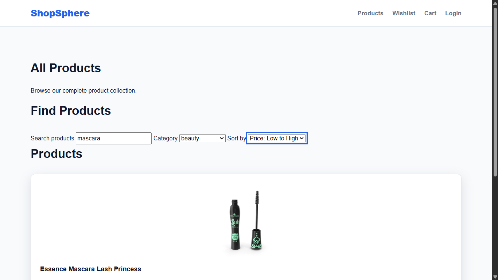
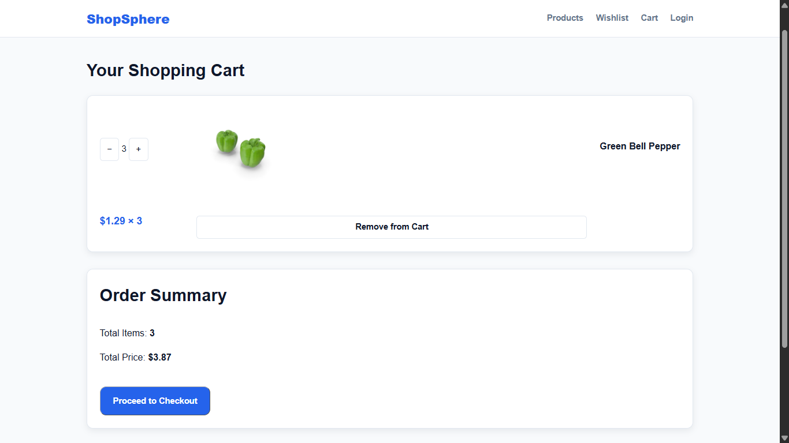
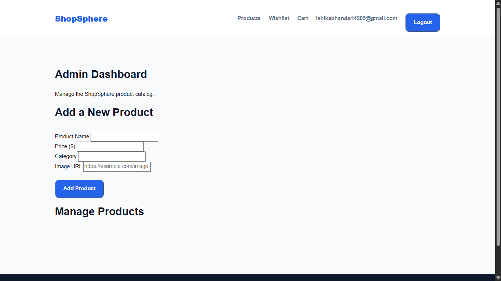

# ShopSphere — Modern E-Commerce Storefront

## Live Demo

**Live Website:** https://shopsphere-storefront.netlify.app

**GitHub Repository:** https://github.com/ishhhhh2/shopsphere

Explore the ShopSphere storefront, browse products, manage your cart and wishlist, and try the simulated login and admin features.

> Note: Authentication and checkout are demonstrations only. No real payments are processed.

## Overview

ShopSphere is a responsive e-commerce storefront built using HTML5, CSS3, and JavaScript. It provides product browsing, search and filtering, a shopping cart, a wishlist, simulated authentication, and an admin dashboard for product management.

## Features

- **Product Catalog:** Fetch products from the DummyJSON REST API.
- **Search, Filter and Sort:** Find products by name or category and sort by price or name.
- **Product Details:** View product images, prices, categories, and descriptions.
- **Shopping Cart:** Add and remove products, update quantities, and calculate totals.
- **Wishlist:** Save and remove favourite products.
- **Authentication Simulation:** Demo login and logout with localStorage-based user state.
- **Admin Dashboard:** Add, edit, and delete products in the local admin catalog.
- **Demo Checkout:** Simulate checkout without processing real payments.
- **Responsive UI:** Support desktop and mobile layouts.
- **Persistent State:** Store selected application data in browser localStorage.

## Tech Stack

- HTML5
- CSS3
- JavaScript ES Modules
- REST API and Fetch API
- Browser localStorage
- VS Code and Live Server

## Project Structure

```text
shopsphere/
├── index.html
├── products.html
├── product.html
├── cart.html
├── wishlist.html
├── login.html
├── admin.html
├── css/
│   ├── style.css
│   └── responsive.css
├── js/
│   ├── app.js
│   ├── api.js
│   ├── auth.js
│   ├── products.js
│   ├── product-details.js
│   ├── cart.js
│   ├── wishlist.js
│   └── admin.js
├── assets/
├── screenshots/
└── README.md
```

## API

Product data is retrieved from:

https://dummyjson.com/products

## Run Locally

1. Clone or download this repository.
2. Open the project folder in VS Code.
3. Install or enable the Live Server extension.
4. Right-click `index.html`.
5. Select **Open with Live Server**.
6. Explore the catalog, cart, wishlist, login page, and admin dashboard.

## Architecture

```text
Browser UI
    ↓
HTML Pages
    ↓
JavaScript Modules
    ├── API Client
    ├── Product Catalog
    ├── Authentication Simulation
    ├── Cart
    ├── Wishlist
    └── Admin CRUD
    ↓
DummyJSON API + Browser localStorage
```

## Important Limitations

- Authentication is simulated and is not secure production authentication.
- Cart and wishlist persistence use browser localStorage.
- Admin changes are stored locally and do not modify the original DummyJSON API.
- Checkout is a demonstration and does not process payments.

## Future Improvements

- Backend API with a database
- Secure authentication and authorization
- Server-side product CRUD
- Real order management and payment integration
- Automated unit and end-to-end tests

## License

This project was created for learning and portfolio demonstration purposes.

## Screenshots

### Homepage


### Product Catalog


### Shopping Cart


### Wishlist


### Admin Dashboard
